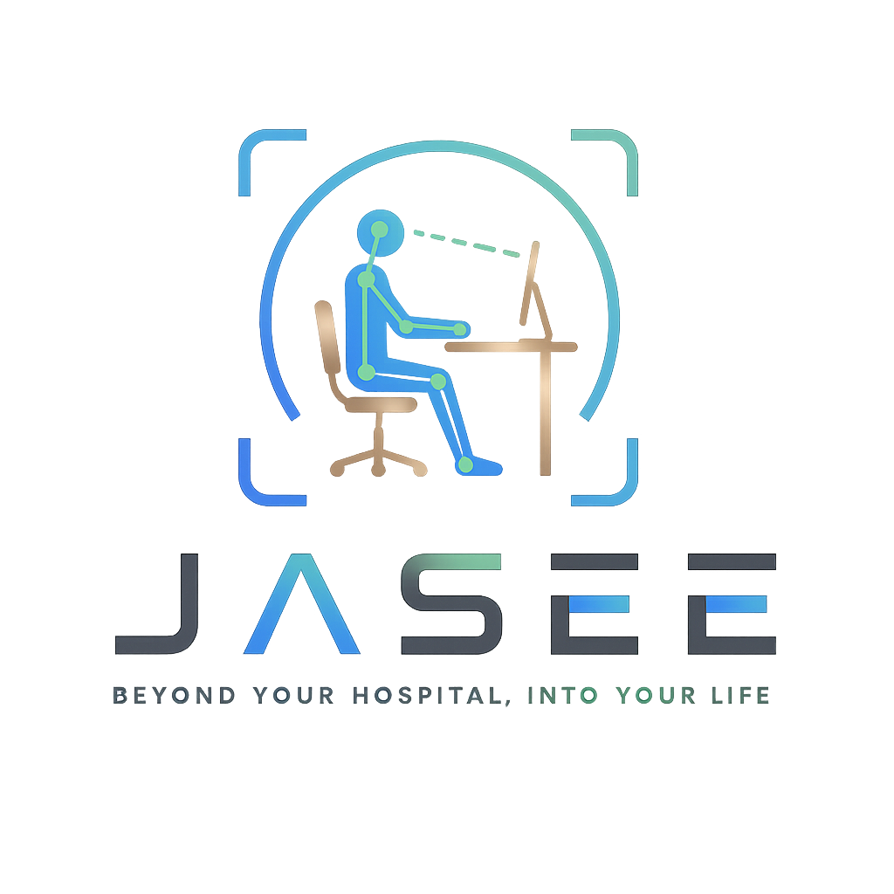

<div align="center">

# 🏥 JASEE (자세히봐)


<div align="center">
  
</div>

> **JASEE**는 YOLOv8-Pose와 Attention MLP를 결합하여 사람의 자세를 실시간 분석하고,  
> 재활 운동 보조 및 헬스케어 피드백을 제공하는 AI 시스템입니다.

</div>

---

## 📌 1. 프로젝트 설명 (Project Description)

JASEE(자세히봐)는 **헬스케어 (Healthcare) / 재활 (Rehabilitation)** 분야를 위한 AI 자세 분석 시스템입니다.

- 사용자의 신체 관절 좌표를 실시간으로 추출하여 자세의 정확도를 분석합니다.
- 작업 환경 내 물체 인식을 병행하여 **맥락 기반 자세 및 작업환경 통합교정 피드백 (Context-based posture and work environment integrated correction feedback)**을 제공합니다.
- RAG (Retrieval-Augmented Generation, 검색 증강 생성) 기반 지식 검색으로 사용자 맞춤 피드백 및 재활 가이드라인을 자동 제공합니다.

```
사용자 영상 입력 (User Video Input)
    │
    ├── YOLOv8-Pose → 관절 좌표 추출 (17개 키포인트 (Keypoints))
    │       │
    │       └── Attention MLP → 자세 분류 (Classification) / 이상 감지 (Anomaly Detection)
    │
    ├── YOLOv8 → 작업 환경 물체 인식 (Object Detection)
    │
    └── RAG → 재활 운동 가이드 (Rehabilitation Guide) + 피드백 생성 (Feedback Generation)
```

---

## 📂 2. 데이터셋 (Datasets)

| 구분 (Category) | 내용 (Details) |
|------|------|
| 자세 데이터 (Posture Data) | COCO Keypoints 기하학 피처 변환 데이터셋 |
| 물체 인식 (Object Detection) | 직접 촬영 및 라벨링된 사무실 작업 환경 이미지 |
| 재활 가이드 (Rehab Guide) | VDT 지침, KOSHA GUIDE, 인체치수 조사 등 의학/공학 문헌 기반 RAG 텍스트 |
| 총 데이터 수 (Total Count) | 자세 데이터: **1,199장** / 물체 데이터: **약 1,698장** (증강 완료) / RAG: **280개 청크 (Chunks)** |
| 학습 / 검증 / 테스트 비율 (Split Ratio) | 자세 모델: **64% : 16% : 20%** / 물체 모델: **8 : 1 : 1** |

> 📎 자세한 가이드 및 문서 소스는 `processed_data/` 및 `자세히봐_RAG/` 디렉토리를 참고하세요.

---

## 📏 3. 측정 기준 (Metrics)

### 자세 분류 (Attention MLP)
| 지표 (Metrics) | 값 (Value) | 비고 (Notes) |
|------|-----|---|
| Accuracy (정확도) | **93.75%** | 테스트 데이터셋 (Test Set) 기준 |
| Precision (정밀도) | **91.02%** | 과적합 (Overfitting) 방지 제어 |
| Recall (재현율) | **95.45%** | **최우선 최적화 지표 (나쁜 자세 검출율)** |
| F1-Score | **93.18%** | 정밀도와 재현율의 균형 지표 |
| AUC | **0.9852** | 높은 분류 신뢰도 달성 |

### 물체 인식 (YOLOv8)
| 지표 (Metrics) | 값 (Value) | 비고 (Notes) |
|------|-----|---|
| mAP@0.5 | **85.0% 이상** | `chair_back`, `chair_seat`, `desk_surface`, `monitor` 4종 감지 |
| mAP@0.5:0.95 | **60.0% 이상** | 경계 상자 (Bounding Box) 정확도 |
| FPS (프레임 수) | **30 FPS 이상** | 실시간 데스크톱/모바일 추론 환경 기준 (GPU 가속 시) |

> 📊 상세 실험 결과는 `Yolo_pose/05_documentation/model_development_report.md` 또는 `Yolo_pose/02_model_comparison/` 을 참고하세요.

---

## 🔧 4. 데이터 전처리 (Data Preprocessing)

```python
# 1. 데이터 누수 (Data Leakage) 원천 차단
# - 단순 2D 좌표 간의 각도 직접 제공 시 정답 유출이 발생하므로 관련 피처 제거
# - 오직 16개의 기하학적 피처(Geometric Features)만을 정의하여 학습에 활용

# 2. 16개 핵심 기하학적 피처 추출 (Feature Engineering)
# - 귀, 어깨, 골반, 무릎, 발목의 2D 좌표 (x, y 좌표 총 10개)
# - 관절 간 유클리드 거리 (Distance) 4개:
#   · 귀-어깨 (ear_sh), 어깨-골반 (sh_hip), 골반-무릎 (hip_kn), 무릎-발목 (kn_ank)
# - 관절 간 내각 (Angle) 2개:
#   · 어깨-골반-무릎 (sh_hip_kn), 골반-무릎-발목 (hip_kn_ank)

# 3. 데이터 증강 (Data Augmentation)
# - 좌우 반전 (Horizontal Flip)
# - 회전 (Rotation ±15°)
# - Albumentations 라이브러리를 활용한 밝기, 대비 조정 적용
```

---

## ⚡ 5. 주요 기능 (Core Features)

| 기능 (Features) | 설명 (Description) |
|------|------|
| 🦴 실시간 자세 분석 | YOLOv8-Pose로 관절 좌표 추출 후 즉각 정밀 피드백 (CVA 목굴곡각, TIA 몸통굴곡각 등 측정) |
| 🏋️ 재활 운동 가이드 | RAG 기반 자세별 올바른 처방법 안내 및 맞춤 스트레칭 추천 |
| 🔍 작업 환경 인식 | YOLOv8로 주변 사물(모니터, 책상, 의자)을 감지하고 신체와의 인체공학적 배치 분석 |
| 📊 자세 이상 감지 | 최적화된 Attention MLP 모델을 사용해 비정상(BAD) 자세 실시간 분류 및 알림 |
| 💬 AI 챗봇 피드백 | OpenAI GPT-4o 기반 개인화 맞춤 건강/재활 피드백 생성 (질병관리청 실시간 데이터 연동) |

---

## 🦴 6. 자세 인식 모델: YOLOv8-Pose + Attention MLP

### YOLOv8-Pose
- **17개 COCO 키포인트 (Keypoints)** 중 핵심 관절점 추출 (귀, 어깨, 골반, 무릎, 발목, 팔꿈치, 손목)
- 실시간 경량 추론 (`yolov8n-pose.pt` 모델 사용)

### Attention MLP (최종 분류 모델)
```
Input: [16차원 정규화 기하학적 피처 벡터]

Architecture:
  MultiheadAttention (embed_dim=16, num_heads=1)
    │
    ├── Linear(16 → 256) → BatchNorm → ReLU → Dropout(0.42)
    ├── Linear(256 → 128) → BatchNorm → ReLU → Dropout(0.42)
    └── Linear(128 → 64) → BatchNorm → ReLU → Dropout(0.42)
    │
  Linear(64 → 1) → Sigmoid
```

**Attention 메커니즘 선택 이유:**
- 신체 각 부위 관절 간의 상관관계(예: 목의 꺾임과 허리 굽힘의 연관성)를 가중치로 동적 학습
- 단순 MLP 대비 자세 분류 성능(Recall) 향상 및 일반화 성능 확보

---

## 🔍 7. 작업 환경 인식: YOLOv8 Object Detection

- **사무실 작업 환경** 내 인체공학 분석용 4대 핵심 사물 인식
- `chair_back` (의자 등받이), `chair_seat` (의자 시트), `desk_surface` (책상 상면), `monitor` (모니터) 감지
- 인식된 물체의 경계 상자 (Bounding Box) 정보와 사람의 관절 위치를 결합하여 배치 적합성(시선각, 책상 높이 등)을 RULA 기준으로 진단

```python
# 사전학습된 YOLOv8 모델 로드 및 미세조정 (Fine-tuning)
model = YOLO('best.pt')  # 학습 완료된 가중치 로드
results = model.predict(source=frame, conf=0.5, iou=0.3)
```

**학습 설정 (Training Config):**
| 파라미터 (Hyperparameters) | 값 (Value) |
|----------|-----|
| Epochs | **100** |
| Batch Size | **16** |
| Image Size | **640** |
| Optimizer | **AdamW** (Ultralytics Auto) |

---

## 📈 8. 모델 성능 평가 및 설정 (Evaluation & Config)

### Attention MLP 학습 설정 (Hyperparameters)
```yaml
optimizer: AdamW
learning_rate: 0.0031
batch_size: 32
epochs: 100
weight_decay: 9.47e-05
dropout_rate: 0.42
scheduler: CosineAnnealingLR
loss: BCEWithLogitsLoss (이진 분류)
threshold: 0.40 (Recall 극대화를 위한 최적 임계값)
```

### 성능 비교 (모델 선택 근거)
`final_comparison.csv`에 기록된 10종의 베이스라인 모델 성능 벤치마킹 데이터 기준:

| 모델 (Model) | Recall (재현율) | F1-Score | AUC | Accuracy | Precision | 비고 (Category) |
| :--- | :--- | :--- | :--- | :--- | :--- | :--- |
| **Attention MLP (Tuned)** | **0.9545** | **0.9318** | **0.9852** | **0.9375** | **0.9102** | **최종 최적화 선택 모델** |
| 1D-CNN | 0.9182 | 0.9099 | 0.9667 | 0.9167 | 0.9018 | 딥러닝(좌표) 비교군 |
| 기본 MLP | 0.9091 | 0.9174 | 0.9826 | 0.9250 | 0.9259 | 딥러닝(좌표) Baseline |
| XGBoost | 0.8636 | 0.8636 | 0.9535 | 0.8750 | 0.8636 | 머신러닝 비교군 |
| Random Forest | 0.8091 | 0.8279 | 0.9276 | 0.8458 | 0.8476 | 머신러닝 비교군 |
| ResNet50 | 0.8182 | 0.7407 | 0.8087 | 0.7375 | 0.6767 | 딥러닝(이미지) 비교군 |

> 📊 학습 곡선 및 세부 데이터 전처리 순서는 `Yolo_pose/` 하위 디렉토리를 참조하세요.

---

## 🔎 9. RAG (Retrieval-Augmented Generation)

```
사용자 질의 또는 자세 이상 감지
        │
        ▼
 ChromaDB Vector DB 검색 (ChromaDB Vector DB Query)
 - 임베딩 모델: jhgan/ko-sroberta-multitask
 - Cosine Similarity 기반 Top-K (기본 5개 문서) 추출
        │
        ├── [일치율 낮을 시 (Distance > 0.7)] ──> 질병관리청(KDCA) 건강정보포털 API 실시간 호출 (Fallback)
        │
        ▼
 OpenAI GPT-4o LLM 분석
 → 신뢰할 수 있는 의학적 근거가 포함된 개인화 재활 피드백 생성
```

**RAG 파이프라인 구성:**
- **문서 임베딩 (Embedding)**: `sentence-transformers` 라이브러리의 `jhgan/ko-sroberta-multitask` 한국어 특화 모델 사용
- **벡터 저장소 (Vector DB)**: ChromaDB (로컬 Persistent Client)
- **검색 방식**: Cosine Similarity 기반 Top-K 및 질병관리청 API 실시간 폴백 연동
- **생성 모델 (LLM)**: OpenAI `gpt-4o` (기본 설정, 환경 변수 `JASEE_MODEL`로 변경 가능)

---

## 🏆 10. 결과 (Results)
### 주요 성과
- ✅ 실시간 자세 분류 정확도: **93.75%** (나쁜 자세 감출 재현율 (Recall): **95.45%**)
- ✅ 작업 환경 물체 인식 mAP@0.5: **85.0% 이상**
- ✅ 피드백 및 답변 응답 속도: **200ms 이하** (로컬 모델 추론 기준)
- ✅ 재활 운동 및 스트레칭 가이드: **4대 주요 자세 패턴(UCS, LCS, FlatBack, SwayBack) 및 30여 종 맞춤형 운동 처방** 지원

---

## 🛠️ 11. 기술 스택 (Tech Stack)

### AI / ML (Artificial Intelligence & Machine Learning)
- **Python** (v3.10+)
- **PyTorch** (v2.5.1+)
- **Ultralytics YOLOv8** (v8.4.0+, Pose & Object Detection)
- **OpenCV** (컴퓨터 비전 데이터 처리 및 실시간 프레임 렌더링)
- **Albumentations** (학습 데이터 증강 라이브러리)

### Backend / API (Services)
- **OpenAI API** (gpt-4o LLM 모델 통합)
- **ChromaDB** (임베딩 벡터 데이터 관리)
- **Sentence-Transformers** (한국어 임베딩 전용 모델)
- **Streamlit & Streamlit-Webrtc** (웹 프런트엔드 및 실시간 카메라 스트리밍 제어)
- **pyttsx3** (사용자 실시간 음성 피드백 TTS 엔진)

---

## 📁 12. 프로젝트 구조 (Project Structure)

```
JASEE/
│
├── 📂 Yolo_env/                        # 작업환경 인식 모델 학습 및 처리
│   ├── 📄 step1_split.py               # train/val/test 데이터셋 분할 (8:1:1)
│   ├── 📄 step2_augmentation.py        # 데이터 증강 처리 (약 3배 확대)
│   └── 📄 step3_train.py               # YOLOv8 custom 학습 스크립트
│
├── 📂 Yolo_pose/                       # 자세 분류 모델 개발 및 성능 개선
│   ├── 📂 01_data_preprocessing/       # 데이터 전처리 및 키포인트 추출
│   ├── 📂 02_model_comparison/         # 10종의 ML/DL 모델 성능 비교 실험
│   ├── 📂 03_model(attetion MLP)_improvement/ # 피처 엔지니어링 및 Optuna 하이퍼파라미터 튜닝
│   ├── 📂 04_final_model/              # 최종 Attention MLP 모델 저장 및 가중치 파일
│   └── 📂 05_documentation/            # 모델 성능 최적화 결과 보고서
│
├── 📂 자세히봐_RAG/                     # RAG 챗봇 구축용 Q&A 및 관련 지침 데이터셋
│   ├── 📂 Q&A/                          # 상황별, 자세별 한글 질의응답 JSON 데이터
│   ├── 📂 기능1~3_자료/                 # VDT 가이드라인 고시 및 RULA 기술 기준서
│   ├── 📂 기능4_부위별 통증 완화 방법 답변/ # 질병 관리 DB 리소스
│   └── 📂 기능5_개인화 맞춤 운동 추천(자세맵핑)/ # 자세 패턴별 운동/스트레칭 상세 DB
│
├── 📂 processed_data/                  # preprocess_jasee.py를 통해 정제된 RAG 전용 청크 JSON
├── 📂 vector_db/                       # ChromaDB 로컬 Persistent 저장소
│
├── 📄 preprocess_jasee.py              # PDF/DOCX/JSON 등 데이터 전처리 및 청크 파싱 파이프라인
├── 📄 build_vectordb.py                # 임베딩 기능을 활용하여 ChromaDB 벡터 DB 구축
├── 📄 chatbot.py                       # RAG 기반 CLI 터미널 챗봇 실행 진입점 (질병관리청 API 포함)
│
├── 📄 jasee_core.py                    # 실시간 자세 및 환경 측정을 위한 백엔드 핵심 연산 모듈
├── 📄 app_mobile.py                    # 모바일 반응형 Streamlit 애플리케이션 메인 소스
├── 📄 app_desktop.py                   # 데스크톱 모드 Streamlit 애플리케이션
├── 📄 app_web.py                       # 웹 데모용 Streamlit 애플리케이션
│
├── 📄 requirements.txt                 # 라이브러리 의존성 설치 파일
└── 📄 README.md                        # 프로젝트 설명서 (본 파일)
```

---

## 🚀 시작하기 (Getting Started)

### 1. 저장소 클론 및 이동
```bash
git clone https://github.com/seungwoo2000/JASEE.git
cd JASEE
```

### 2. 가상환경 생성 및 활성화
```bash
conda create -n Yolo_env python=3.10 -y
conda activate Yolo_env
```

### 3. 필수 패키지 설치
```bash
pip install -r requirements.txt
pip install torch torchvision torchaudio --index-url https://download.pytorch.org/whl/cu121
```
> 💡 RAG 및 챗봇 모듈을 로컬에서 정상적으로 빌드하고 실행하려면 아래 패키지가 추가적으로 필요합니다:
> `pip install chromadb sentence-transformers openai python-docx PyMuPDF tqdm python-dotenv`

### 4. 모델 가중치 확인 및 배치
서비스 구동을 위해 다음의 3개 모델 가중치 파일이 제 위치에 올바르게 다운로드/배치되었는지 확인합니다:
- `JASEE/yolov8n-pose.pt`
- `JASEE/Yolo_pose/04_final_model/output/final_attention_mlp.pt`
- `JASEE/Yolo_env/images_data/runs/posture_v1/weights/best.pt`

### 5. 환경 변수 설정
프로젝트 루트 폴더에 `.env` 파일을 생성하고 아래 API Key 값을 입력합니다:
```env
OPENAI_API_KEY=your_openai_api_key_here
KDCA_API_KEY=your_kdca_api_key_here  # 질병관리청 실시간 데이터 연동용 (선택 사항)
```

### 6. 서버 실행 (Run Streamlit App)
```bash
# 모바일 권장 모드로 Streamlit 웹 어플리케이션 실행
python -m streamlit run app_mobile.py

# 데스크톱 환경 모드로 실행 시
python -m streamlit run app_desktop.py
```

---

<div align="center">

**JASEE** - 자세히봐, 더 건강하게 🏥

</div>
